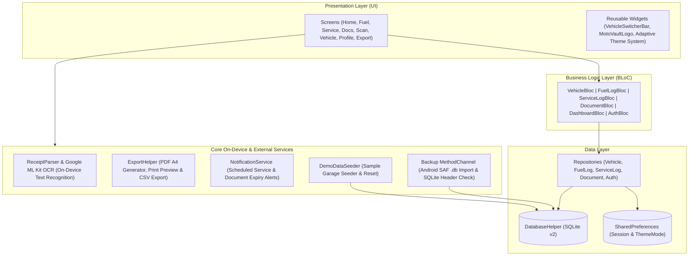
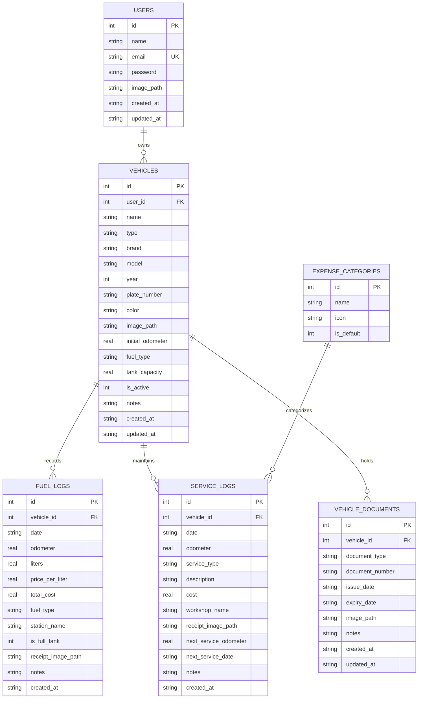

# MotoVault — Offline-First Vehicle & Garage Management

<p align="center">
  
</p>

<p align="center">
  <strong>Aplikasi Manajemen Kendaraan, Konsumsi BBM, Servis Berkala & Dokumen Berbasis Offline-First (Flutter + SQLite + BLoC)</strong>
</p>

<p align="center">
  <a href="https://github.com/sukr02k/motovault/actions/workflows/flutter_ci.yml">
    
  </a>
  <a href="https://github.com/sukr02k/motovault/releases/latest">
    
  </a>
  
  
  
  
</p>

---

## Ringkasan Project (Overview)

**MotoVault** adalah aplikasi pencatatan operasional dan perawatan kendaraan pribadi (sepeda motor maupun mobil) yang dirancang dengan pendekatan **100% Offline-First**. Seluruh pencatatan konsumsi bahan bakar (`km/L`), riwayat servis berkala, pemantauan masa berlaku dokumen kendaraan (STNK, Pajak Tahunan/PKB, BPKB, SIM, Asuransi), hingga pemindaian struk SPBU/bengkel berbasis *on-device OCR* berjalan langsung di perangkat menggunakan **SQLite** tanpa ketergantungan koneksi internet.

Untuk menjaga keamanan data pada skenario *offline*, aplikasi ini dilengkapi dengan sistem **Backup & Restore Database (`.db`)** bervalidasi header SQLite (termasuk impor langsung dari penyimpanan perangkat via Android Storage Access Framework), ekspor laporan kendaraan ke format **PDF (A4)** dan **CSV**, serta fitur **Demo Data Seeder** untuk memudahkan pengujian fitur secara langsung.

---

## Fitur Utama

### 1. Manajemen Garasi Multi-Kendaraan
- **Multi-Profil Kendaraan**: Pencatatan sepeda motor dan mobil lengkap dengan nomor polisi, merk, model, tahun, kapasitas tangki, jenis BBM utama, dan foto kendaraan.
- **Vehicle Switcher Cepat**: Pemilih kendaraan aktif langsung di halaman *Beranda*, *BBM*, dan *Servis* tanpa perlu berpindah tab.
- **Sinkronisasi & Rekalkulasi Odometer Otomatis**: Memperbarui dan menghitung ulang nilai odometer tertinggi kendaraan secara otomatis setiap kali catatan BBM atau servis ditambah, diedit, maupun dihapus.

### 2. Pencatatan & Analitik BBM
- **CRUD Transaksi BBM Lengkap**: Pencatatan dan pengeditan riwayat pengisian BBM (tanggal, jenis BBM, volume liter, harga per liter, total biaya, odometer, nama SPBU, status *full tank*, dan foto struk).
- **Kalkulasi Efisiensi Bahan Bakar (`km/L`)**: Menghitung konsumsi bahan bakar rata-rata dan biaya per pengisian secara akurat.
- **Proteksi Validasi Odometer**: Mencegah kesalahan input odometer yang lebih rendah dari catatan sebelumnya pada pengisian baru.
- **Visualisasi Grafik 6 Bulan**: Grafik batang pengeluaran bulanan interaktif menggunakan `fl_chart`.

### 3. Riwayat Servis & Brankas Dokumen
- **CRUD Riwayat Servis Berkala**: Pencatatan dan pembaruan rincian perbaikan/servis berkala beserta pengingat jadwal servis berikutnya berdasarkan target tanggal maupun batas kilometer odometer.
- **Pemantauan Masa Berlaku Dokumen**: Penyimpanan data STNK, Pajak Tahunan (PKB), BPKB, SIM, dan Asuransi dengan indikator status (*Aktif*, *Segera Habis*, *Kadaluarsa*) serta notifikasi lokal terjadwal.
- **Perpanjangan Cepat Dokumen**: Pintasan perpanjangan masa berlaku dokumen (`+1 Tahun` dan `+5 Tahun`) langsung dari kartu dokumen maupun halaman formulir.

### 4. On-Device OCR, Laporan & Keamanan Data
- **Scan Nota SPBU & Bengkel (On-Device OCR)**: Ekstraksi otomatis tanggal transaksi, liter BBM, harga per liter, jenis BBM, dan total biaya dari foto struk menggunakan **Google ML Kit Text Recognition**.
- **Ekspor Laporan PDF (A4) & CSV**: Pembuatan laporan riwayat kendaraan siap cetak (dilengkapi pratinjau cetak via `printing`) serta ekspor spreadsheet `.csv` via `share_plus`.
- **Backup & Restore Database Lokal (`.db`)**: Pencadangan dan pemulihan file database SQLite `kendaraanku.db` dari penyimpanan perangkat dengan validasi *magic bytes* header `SQLite format 3`.
- **Keamanan Akun & Tema Adaptif**: Penyimpanan password akun lokal menggunakan *Salted SHA-256* serta dukungan tema **Terang**, **Gelap**, dan **Ikuti Sistem** secara *real-time*.

---

## Arsitektur Aplikasi

Aplikasi ini mengimplementasikan pemisahan lapisan yang tegas antara **Presentation Layer (UI)**, **Business Logic Layer (BLoC)**, **Core On-Device Services**, dan **Data Layer (Repositories & SQLite)**:



### Struktur Direktori

```text
lib/
├── core/
│   ├── components/       # Komponen UI reusable (BottomNav, Buttons, VehicleSwitcherBar, MotoVaultLogo)
│   ├── constants/        # Sistem warna adaptif Light/Dark (AppColors), tipografi, dan konstanta string
│   ├── services/         # Penjadwalan notifikasi lokal (NotificationService)
│   ├── utils/            # Formatters (id_ID), ReceiptParser (OCR), ExportHelper (PDF/CSV), PasswordHasher (SHA-256)
│   ├── theme.dart        # Konfigurasi ThemeData terang dan gelap
│   └── theme_controller.dart
├── data/
│   ├── local/            # AuthLocalDatasource & DemoDataSeeder
│   ├── models/           # Model entitas (User, Vehicle, FuelLog, ServiceLog, VehicleDocument)
│   ├── repositories/     # Abstraksi query CRUD & rekalkulasi odometer otomatis
│   └── database_helper.dart # Konfigurasi skema SQLite v2 & migrasi tabel
├── presentation/
│   ├── auth/             # SplashPage, OnboardingPage, LoginPage, RegisterPage
│   ├── blocs/            # State management berbasis BLoC (Vehicle, FuelLog, ServiceLog, Document, Dashboard, Auth)
│   ├── docs/             # Halaman daftar dokumen, tambah/edit dokumen, & perpanjangan masa berlaku
│   ├── fuel/             # Halaman log BBM, statistik 6 bulan (fl_chart), & form tambah/edit BBM
│   ├── home/             # MainNavigationPage (5 tab) & HomePage
│   ├── notifications/    # Halaman daftar pengingat servis & masa berlaku dokumen
│   ├── profile/          # Halaman Profil, Keamanan, Tema, & Backup/Restore Database (.db)
│   ├── scan/             # Halaman pemindaian struk kamera/galeri dengan Google ML Kit OCR
│   ├── service/          # Halaman riwayat servis & form tambah/edit servis
│   ├── settings/         # Halaman ekspor laporan PDF A4 & CSV
│   └── vehicle/          # Halaman detail, tambah, dan edit kendaraan
└── main.dart             # Entry point aplikasi
```

---

## Skema Database (ERD)

Database lokal SQLite (`DatabaseHelper`, versi 2) terdiri dari **6 tabel** yang dilengkapi *Foreign Key Constraints* untuk menjaga integritas relasional antar pengguna, kendaraan, catatan operasional, dan dokumen:



---

## Tech Stack

| Kategori | Paket / Teknologi | Kegunaan |
| :--- | :--- | :--- |
| **Framework & Bahasa** | Flutter & Dart (`^3.7.0`) | Cross-platform UI & aplikasi mobile |
| **State Management** | `flutter_bloc` (`^9.0.0`) & `dartz` | Event-driven BLoC state management & functional error handling |
| **Local Database** | `sqflite` (`^2.4.1`) & `shared_preferences` | Penyimpanan relasional offline (SQLite v2) & preferensi tema/sesi |
| **On-Device OCR** | `google_mlkit_text_recognition` (`^0.15.0`) | Ekstraksi teks struk SPBU & nota servis secara lokal di perangkat |
| **Data Visualization** | `fl_chart` (`^0.70.2`) | Grafik analisis pengeluaran BBM & servis 6 bulan terakhir |
| **Report & Export** | `pdf` (`^3.11.3`), `printing` & `csv` | Pembuatan laporan PDF A4, pratinjau cetak, dan ekspor CSV |
| **Keamanan & Utilitas** | `crypto` (`^3.0.6`), `flutter_local_notifications` | Salted SHA-256 password hashing & pengingat lokal terjadwal |

---

## Cara Menjalankan Project

### 1. Prasyarat
- Flutter SDK `>= 3.7.0`
- Android Studio / VS Code
- Java 17 (untuk build Android)

### 2. Instalasi & Menjalankan Aplikasi

```bash
# Unduh dependencies
flutter pub get

# Jalankan analisis kode & unit test
flutter analyze
flutter test

# Jalankan aplikasi di perangkat / emulator
flutter run
```

### 3. Akun Demo & Data Sampel
Untuk mengisi data sampel secara instan (2 kendaraan, 6 bulan riwayat BBM, catatan servis berkala, serta dokumen STNK/Pajak/SIM):
- Tekan tombol **Mode Demo** pada layar *Onboarding* atau *Login*, atau melalui menu **Profil → Muat Data Demo**.
- Seluruh data sampel dapat dibersihkan kapan saja melalui menu **Profil → Kosongkan Garasi**.
