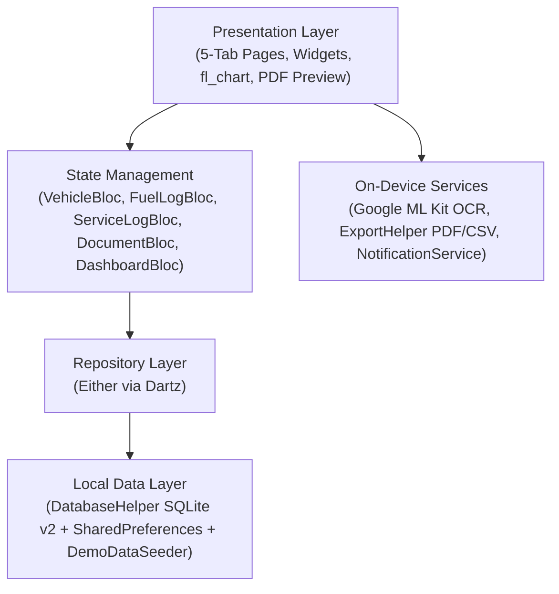

<div align="center">
  
  <h1>MotoVault</h1>
  <p><strong>Smart Vehicle & Garage Ledger — 100% Offline Flutter App</strong></p>

  <p>
    <a href="https://github.com/sukr02k/motovault/actions/workflows/flutter_ci.yml"></a>
    <a href="https://github.com/sukr02k/motovault/releases/latest"></a>
    
    
    
    
  </p>
</div>

---

## Ringkasan

**MotoVault** adalah aplikasi manajemen garasi & kendaraan pribadi berbasis **Flutter** yang berjalan **100% offline** di perangkat pengguna. Dirancang untuk pemilik sepeda motor maupun mobil di Indonesia yang ingin memantau konsumsi BBM (`km/L`), riwayat servis berkala, masa berlaku dokumen legal (**STNK, Pajak Tahunan PKB, SIM, BPKB, Asuransi**), pemindaian struk SPBU/bengkel otomatis berbasis **Google ML Kit On-Device OCR**, serta ekspor laporan kendaraan siap cetak (**PDF A4 & CSV**).

---

## Fitur Unggulan

- **Garasi Multi-Kendaraan & Sinkronisasi Odometer Otomatis**: Kelola motor & mobil sekaligus dengan chip pemilih cepat di Beranda; odometer kendaraan otomatis diperbarui setiap kali Anda mencatat BBM atau servis baru.
- **Mode Demo Instan 1-Tap (Recruiter Ready)**: Tersedia tombol **Mode Demo** di halaman Onboarding, Login, Beranda kosong, dan Profil yang langsung mengisi 2 kendaraan realistis (*Honda Vario 160 ABS* & *Toyota Kijang Innova Zenix Hybrid*), 6 bulan riwayat BBM, servis berkala, serta dokumen STNK/Pajak/SIM untuk eksplorasi instan tanpa registrasi.
- **Analitik Konsumsi BBM & Grafik Tren 6 Bulan**: Hitung efisiensi bahan bakar (`km/L`), harga per liter, total pengeluaran bulanan, dan visualisasi grafik batang interaktif menggunakan `fl_chart`.
- **Scan Nota SPBU & Bengkel (On-Device OCR)**: Ekstrak otomatis tanggal transaksi, liter BBM, harga per liter, jenis BBM (*Pertamax, Pertalite, Shell, BP*), nama SPBU/bengkel, dan total bayar menggunakan **Google ML Kit Text Recognition** tanpa koneksi internet.
- **Brankas Dokumen & Pengingat Pajak/Servis**: Pantau masa berlaku **STNK, Pajak Tahunan, SIM, BPKB, dan Asuransi** lengkap dengan indikator warna (*Aktif, Segera Habis, Kadaluarsa*) dan notifikasi lokal terjadwal.
- **Pratinjau Cetak PDF A4 & Ekspor CSV**: Buat laporan lengkap kendaraan dalam format **PDF A4** (dilengkapi pratinjau cetak langsung via `printing`) maupun **CSV** dan bagikan instan melalui `share_plus`.
- **Backup & Restore Database SQLite Lokal**: Cadangkan dan pulihkan seluruh file database `kendaraanku.db` kapan saja, lengkap dengan dukungan tema **Terang, Gelap, dan Ikuti Sistem** secara reaktif.

---

## Arsitektur & Struktur Direktori

Aplikasi ini dibangun menggunakan pendekatan **Layered Clean Architecture** dengan pemisahan tegas antara `core`, `data`, dan `presentation` (**BLoC Pattern**):



```text
lib/
├── core/
│   ├── components/       # Reusable UI kit (BottomNav 5-tab, AppCard, StatusPill, SectionTitle)
│   ├── constants/        # Deep Cobalt & Electric Cyan palette, typography & app strings
│   ├── services/         # Local notification scheduler (flutter_local_notifications)
│   ├── utils/            # Formatters (id_ID), ReceiptParser (OCR heuristics), ExportHelper (PDF/CSV)
│   └── theme_controller.dart
├── data/
│   ├── local/            # SQLite DatabaseHelper (v2), AuthLocalDatasource, DemoDataSeeder
│   ├── models/           # VehicleModel, FuelLogModel, ServiceLogModel, VehicleDocumentModel
│   └── repositories/     # CRUD repositories + automatic odometer synchronization
├── presentation/
│   ├── auth/             # SplashPage, OnboardingPage, LoginPage (+1-Tap Demo), RegisterPage
│   ├── blocs/            # VehicleBloc, FuelLogBloc, ServiceLogBloc, DocumentBloc, DashboardBloc
│   ├── documents/        # DocumentsPage, AddDocumentPage, DetailDocumentPage
│   ├── fuel/             # FuelPage (6-month fl_chart + filters), AddFuelLogPage
│   ├── home/             # MainNavigationPage (5 tabs), HomePage (Hero card, Quick Actions, Reminders)
│   ├── notifications/    # NotificationsPage (Service & Document expiry alerts)
│   ├── profile/          # ProfilePage, ThemePage, BackupPage, AboutPage, PrivacyPage, TermsPage
│   ├── scan/             # ScanReceiptPage (Camera/Gallery -> ML Kit OCR -> Auto-fill)
│   ├── service/          # ServicePage, AddServiceLogPage
│   ├── settings/         # ExportPage (PDF A4 preview/print & CSV share)
│   └── vehicle/          # DetailVehiclePage, AddVehiclePage, EditVehiclePage
└── main.dart
```

---

## Tech Stack

| Kategori | Paket / Teknologi | Kegunaan |
| :--- | :--- | :--- |
| **Framework & Bahasa** | Flutter 3.x · Dart 3.x | Cross-platform UI SDK |
| **State Management** | `flutter_bloc` · `dartz` | Predictable state & functional error handling (`Either`) |
| **Database Lokal** | `sqflite` · `shared_preferences` | Relational SQLite storage (`users`, `vehicles`, `fuel_logs`, `service_logs`, `vehicle_documents`) |
| **Computer Vision (OCR)** | `google_mlkit_text_recognition` | Ekstraksi teks struk SPBU & nota servis 100% on-device |
| **Visualisasi Data** | `fl_chart` | Grafik tren pengeluaran BBM & servis 6 bulan terakhir |
| **Laporan & Berbagi** | `pdf` · `printing` · `csv` · `share_plus` | Pembuatan laporan PDF A4, pratinjau cetak, dan ekspor CSV |
| **Notifikasi Lokal** | `flutter_local_notifications` · `timezone` | Pengingat jadwal servis berkala & masa berlaku pajak/dokumen |

---

## Cara Menjalankan di Lokal

1. **Clone repositori**
   ```bash
   git clone https://github.com/sukr02k/motovault.git
   cd motovault
   ```
2. **Instal dependensi**
   ```bash
   flutter pub get
   ```
3. **Jalankan analisis & pengujian**
   ```bash
   flutter analyze
   flutter test
   ```
4. **Jalankan aplikasi atau build APK rilis**
   ```bash
   flutter run
   # Atau build split-per-ABI release APK:
   flutter build apk --release --split-per-abi
   ```

> **Tips Eksplorasi Cepat**: Tekan tombol **"Demo"** pada halaman Login atau Onboarding untuk langsung memuat 2 kendaraan contoh beserta 6 bulan riwayat BBM, servis, dan dokumen pajak.

